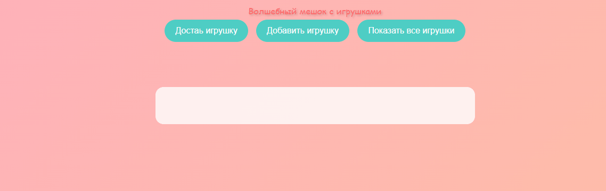

## Проект "Магический мешок"

## Описание проекта
Данный проект создан в рамках образовательного курса. При запуске проекта на экране появятся 3 кнопки. Первая кнопка достаёт игрушку из мешка. Вторая добавляет игрушку в мешок, а третья показывает все игрушки в мешке.

## Цель проекта
Это простая игра с возможностью доставать и добавлять игрушки, а также смотреть все игрушки находяшиеся в мешке.

## Используемые технологии
В script.js хранятся функции и обращение к переменной:
- функция getRandomToy() выбирает случайный элемент из массива и  показывает его в HTML.
- getToyBtn.addEventListener добавляет обработчик клика для кнопки 'достать игрушку'.
- функция addToy() добавляет новый символ в массив.
- addToyBtn.addEventListener добавляет обработчик клика для кнопки 'добавить игрушки'.
- функция showAllToys() выводит все игрушки на страницу в отдельном блоке.
- showAllBtn.addEventListener добавляет обработчик клика для кнопки 'показать все игрушки'.
index.html:
- div-блок с классом container. Этот блок хранит в себе все остальные блоки.
- div-блок с классом main-title. Этот блок хранит в себе заголовок страницы.
- div-блок с классом controls. Этот блок хранит в себе кнопки.
- div-блок с классом output. Этот блок хранит в себе другие 2 div-блока.
- div-блок с id result. В этом блоке появдяется название случайной игрушки.
- div-блок с классом toys-list и id toysList. В этом блоке список всех игрушек, которые лежат в мешке.
- div-блок с классом bag. Это декоративный блок.
style.css:
Прописаны стили.

## Установка зависимостей
Для запуска проекта нужно установить файлы проекта и открыть их с помощью любого браузера.

## Пример запуска
Для того чтобы открыть игру нужно скачать и разархивировать проект, после открыть с помощью браузера.

Проект выполнен в образовательных целях на онлайн курсе "Основы web-разработки " школы Лидер".